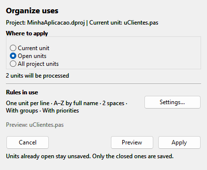
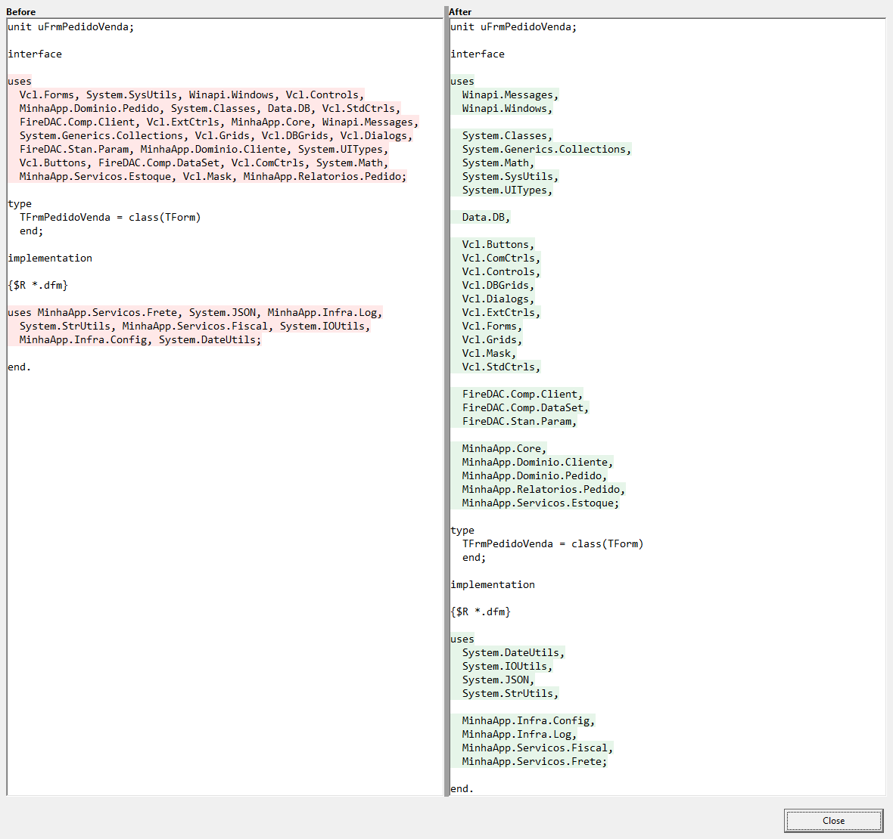
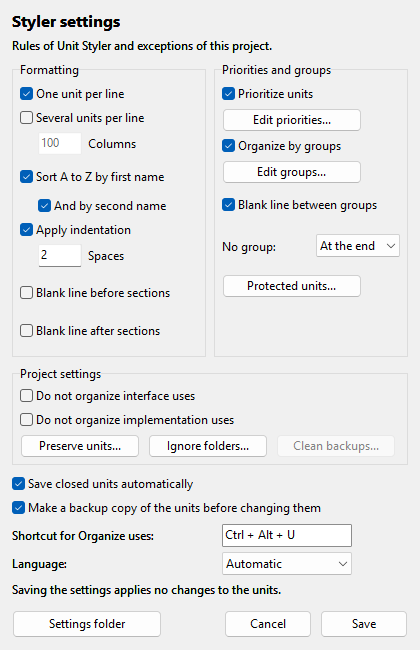

# CS.Coder Unit Styler (beta)

> [!WARNING]
> **BETA VERSION.** CS.Coder Unit Styler is in beta: it is still being tested and may have defects.
> Keep your project under version control or leave the backup option on, and check the
> preview before applying changes to a whole project.
> Please report anything you find by opening an
> [issue](https://github.com/cscoder69/delphi-unit-styler/issues).

**English** | [Português (Brasil)](README.pt-BR.md)

CS.Coder Unit Styler is an extension for the Delphi 11, 12 and 13 IDE that organizes the
`uses` clauses of the units of the project you have open: one unit per line or several,
sorted, indented, with priorities and groups that you define.

It runs only when you ask, shows a before/after preview and asks for confirmation before
changing anything. Units that are open in the editor are changed there, with Undo.

Free and open source under the [MIT License](LICENSE.txt), by
[CS.Coder](https://www.cscoder.com.br).



*The Organize uses window. The screenshots on this page show the windows of the product
outside the IDE; project and unit names are examples.*

## Quick overview

- **Your layout.** One unit per line, or several per line up to a column limit.
- **Sorted.** A to Z by the first part of the name, optionally by the second part too.
- **Priorities and groups.** Units you choose come first; groups by name or prefix, such
  as `System.*`, with an optional blank line between them.
- **Three scopes.** The current unit, the open units or every unit of the project.
- **Preview first.** A before/after comparison of each unit, without changing anything.
- **Nothing happens by itself.** It never runs on open, save or compile, and it always
  asks for confirmation.
- **Careful with your code.** Comments, compiler directives, paths (`in '...'`), encoding
  and line breaks are kept. What is ambiguous is left as it is, with the reason shown.
- **Backup.** Before a unit is changed, the file is copied to a `.backup` folder of the
  project.
- **Part of the IDE.** Menu, shortcut and editor context menu; follows the light and dark
  themes.
- **In your language.** English, Portuguese, Spanish, German and French.

## Using it

Open a project, then open **Organize uses** in any of these ways:

- menu **CS.Coder > Unit Styler > Organize uses...**
- shortcut **Ctrl+Alt+U**, with the code editor in focus (you can change it in Settings)
- right-click in the code editor, **Unit Styler: Organize uses...**

Choose where to apply:

| Scope | What it covers |
|---|---|
| Current unit | The unit in the active editor tab |
| Open units | Every unit of the project that is open in the editor |
| All project units | Every unit that belongs to the project |

Only units that belong to the open project are considered. Files that are in the project
folder but not in the project are not touched.

**Preview** opens the before/after comparison. **Apply** analyses the scope, tells you how
many units will change and asks Yes or No. You do not have to open the preview first.



*The same unit before and after: 34 units in the `uses` clauses, one per line, sorted and
separated in groups.*

### What is saved and what is not

- **Units open in the editor** are changed in the editor and are never saved by the tool.
  You can undo with Ctrl+Z and you decide when to save.
- **Units that were closed** are rewritten on disk, in their original encoding, when
  **Save closed units automatically** is checked (the default). Unchecked, they are opened
  in the editor and left modified, for you to save.

A unit that cannot be read or written does not stop the others. The report at the end
lists each one with the reason.

## Rules



Open them in **CS.Coder > Unit Styler > Settings...**. Saving the settings changes no
unit.

### Formatting

| Option | Effect |
|---|---|
| One unit per line | Each unit on its own line |
| Several units per line | Lines filled up to the column limit (40 to 500, default 100) |
| Sort A to Z by first name | Compares the part before the first dot; units with the same first part keep the order they had |
| And by second name | Also sorts by the second part of the name |
| Apply indentation | Number of spaces before each unit |
| Blank line before / after sections | Spacing around `interface`, `uses`, `implementation`, `initialization` and `finalization` |

With every option unchecked, the text is not changed.

### Priorities and groups

- **Prioritize units** moves the units you list to the top, in the order of your list.
- **Organize by groups** gathers units by exact name or by prefix (`System.*`,
  `MyApp.*`). The first group that matches wins. Units in no group go to the start or to
  the end, as you choose.
- **Blank line between groups** separates them.

### Protected units

The order of the `uses` clause matters to the compiler: when two units declare the same
name, the one listed last is used. Changing the order of the Delphi libraries can
therefore change what your code calls.

For that reason Unit Styler comes with a list of protected units that never change
places: `Winapi.*`, `System.*`, `Vcl.*`, `FMX.*`, `Data.*` and their older names without
prefix. Other units are organized around them. The list can be edited in
**Protected units...**, which has a button to restore the default.

The same applies to your own units: if two of them declare the same name, check the
preview before applying a sort to that project, or add them to **Preserve units...**.

### Settings of each project

| Option | Effect |
|---|---|
| Do not organize interface uses / implementation uses | Leaves that clause as it is in every unit of the project |
| Preserve units... | Units that keep their position; the others are organized around them |
| Ignore folders... | Folders and files that are never analysed or changed, for example third-party code added to the project |
| Clean backups... | Shows the backup copies of the project and deletes them when you confirm |

## What is preserved

- **Comments.** Comments at the top of the clause stay at the top. A comment at the end
  of a unit's line goes with that unit. A clause with a comment on a line of its own in
  the middle is left as it is, and the preview says so.
- **Compiler directives.** A block such as `{$IFDEF X} UnitA, {$ENDIF}` stays intact and
  in place; the units before and after it are organized without crossing it.
- **Paths.** Declarations with `in '...'` are kept.
- **Encoding and line breaks.** ANSI, UTF-8 with or without BOM and UTF-16 files are
  written back in the same encoding, with the same kind of line break.

## Backup

With **Make a backup copy of the units before changing them** checked (the default), each
file that is going to change is first copied, as it is on disk, to:

```
<project folder>\.backup\<yyyy-mm-dd_hh-nn-ss>\
```

There is one subfolder per run, repeating the folder structure of the project. If the
copy fails, the unit is not changed. **Clean backups...** removes only the folders created
by the tool.

## Installation

### Supported versions

| Delphi | 32-bit IDE | 64-bit IDE |
|---|---|---|
| 11 Alexandria | Yes | Not applicable |
| 12 Athens | Yes | Yes |
| 13 Florence | Yes | Yes |

### Steps

The packages are built with Delphi 11.3, 12.3 and 13.1. A single download covers all of
them, and no compiler is needed to install.

1. **Download.** Open the [Releases page](https://github.com/cscoder69/delphi-unit-styler/releases),
   pick the latest release and, under **Assets**, download the file named
   `CSCoderUnitStyler-<version>.zip`. Do not pick "Source code": that one has no
   installer.
2. **Extract.** Unzip the whole file into a folder of your choice. `Install.bat` needs the
   other files that come with it.
3. **Close Delphi.** Close every Delphi window. The installer stops with a message if
   Delphi is running, because the IDE rewrites its package list when it closes.
4. **Run `Install.bat`.** Double-click it. It needs no administrator rights and installs
   for the current Windows user, in every supported Delphi it finds. It prints one line per
   Delphi, for example `[OK] Delphi 12 (32-bit, 64-bit)`.
5. **Open Delphi.** The **CS.Coder** menu appears in the main menu of the IDE, with
   **Unit Styler** inside it.

A Delphi that this Windows user has never opened is reported as `[--]`: open it once,
close it and run `Install.bat` again.

### Checking each stage

| Stage | How to tell |
|---|---|
| Installation completed | `Install.bat` printed `[OK]` for your Delphi. The packages are in `%LOCALAPPDATA%\CSCoder\UnitStyler\bin`. |
| Package loaded | **Component > Install Packages** lists it, checked, as "CS.Coder - Unit Styler". |
| Commands available | The main menu has **CS.Coder > Unit Styler**, with Organize uses, Settings and About. The right-click menu of the code editor has **Unit Styler: Organize uses...**. **About** shows the installed version. |

### Updating

Download the newer zip, close Delphi and run its `Install.bat`. Your settings are kept.

## Uninstallation

Close Delphi first. The uninstaller, like the installer, stops if Delphi is running.

### Remove the extension and keep your settings

```
Uninstall.bat
```

This removes Unit Styler from every Delphi version and deletes the installed packages.
Your rules and the settings of your projects are kept, so installing again brings
everything back.

### Remove the extension and its settings

```
Uninstall.bat /data
```

> [!WARNING]
> This also deletes the rules of every Delphi version (formatting, priorities, groups,
> protected units, shortcut and language) and the settings of every project. It cannot be
> undone. To keep a copy, save the folder `%LOCALAPPDATA%\CSCoder\UnitStyler` before
> running it.

Neither command touches your projects, nor the `.backup` folders inside them.
## Specifications

| | |
|---|---|
| Type | Design-time package for the Delphi IDE |
| Delphi versions | 11 Alexandria, 12 Athens and 13 Florence |
| IDE | 32-bit (11, 12 and 13) and 64-bit (12 and 13) |
| Scope | Units of the open project: current, open or all |
| Theme | Follows the IDE theme, light or dark |
| Languages | English, Portuguese, Spanish, German and French, chosen from the language of Windows or set in Settings |
| Settings | JSON files in `%LOCALAPPDATA%\CSCoder\UnitStyler` |
| Windows registry | Not used for settings. The installer only adds the package to the list of packages the IDE loads |
| Network | Not used. No data is collected or sent |
| Installation | Per Windows user, with no administrator rights |
| License | MIT, free and open source |

## Where the settings are stored

```
%LOCALAPPDATA%\CSCoder\UnitStyler\D11\settings.json
%LOCALAPPDATA%\CSCoder\UnitStyler\D12\settings.json
%LOCALAPPDATA%\CSCoder\UnitStyler\D13\settings.json
%LOCALAPPDATA%\CSCoder\UnitStyler\projects\<project>.<id>.json
```

- The rules (formatting, priorities, groups, protected units, shortcut, language) are
  kept per Delphi version and are the same for all your projects in that version.
- The settings of each project are the same in every Delphi version. A project is
  identified by the `ProjectGuid` of its `.dproj`, so it keeps its settings when it is
  moved or renamed.
- Nothing is written next to your project, except the `.backup` folder described above.
- The **Settings folder** button opens this folder in Explorer.

## Other CS.Coder tools

- [CS.Coder Project Hub](https://github.com/cscoder69/delphi-project-hub): project
  shortcuts organized in categories and groups, on the Delphi Welcome Page.

Each tool is installed on its own. When more than one is installed, they share the
**CS.Coder** menu.

## Contributing and support

- **Problems and suggestions:** open an
  [issue](https://github.com/cscoder69/delphi-unit-styler/issues).
- **Contributions:** pull requests are welcome. For a larger change, please open an issue
  first so we can agree on the approach.
- **Contact:** contato@cscoder.com.br

## License and acknowledgements

Released under the [MIT License](LICENSE.txt). Copyright (c) 2026 CS.Coder.

"Delphi" and "RAD Studio" are trademarks of Embarcadero Technologies, Inc. CS.Coder Unit
Styler is an independent project. It is not affiliated with, maintained by or endorsed by
Embarcadero.
