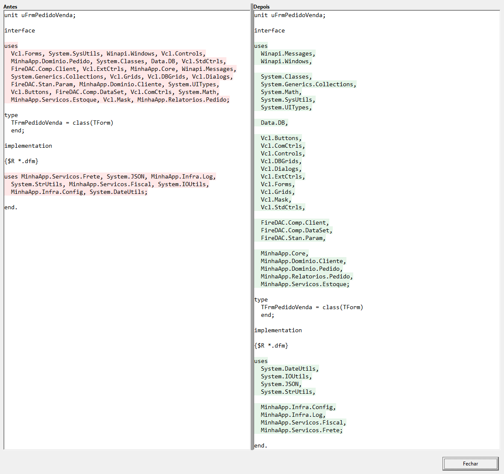

# CS.Coder Unit Styler (beta)

> [!WARNING]
> **VERSÃO BETA.** O CS.Coder Unit Styler está em beta: ainda está em teste e pode ter defeitos.
> Mantenha o projeto em controle de versão ou deixe a cópia de segurança ligada, e confira
> a prévia antes de aplicar alterações em um projeto inteiro.
> Se encontrar algum problema, avise abrindo uma
> [issue](https://github.com/cscoder69/delphi-unit-styler/issues).

[English](README.md) | **Português (Brasil)**

O CS.Coder Unit Styler é uma extensão para a IDE do Delphi 11, 12 e 13 que organiza as
cláusulas `uses` das units do projeto aberto: uma unit por linha ou várias, em ordem,
com indentação, prioridades e grupos definidos por você.

Ele só roda quando você pede, mostra uma prévia do antes e depois e pede confirmação
antes de alterar qualquer coisa. Units abertas no editor são alteradas ali, com Desfazer.

Gratuito e de código aberto sob a [Licença MIT](LICENSE.txt), da
[CS.Coder](https://www.cscoder.com.br). Há um resumo da licença em português em
[LICENCA.txt](LICENCA.txt).


*A janela Organizar uses. As imagens desta página mostram as janelas do produto fora da
IDE, com a interface em inglês; nomes de projeto e de units são exemplos.*

## Visão rápida

- **Do seu jeito.** Uma unit por linha, ou várias por linha até um limite de colunas.
- **Em ordem.** De A a Z pela primeira parte do nome e, se quiser, também pela segunda.
- **Prioridades e grupos.** As units que você escolher vêm primeiro; grupos por nome ou
  prefixo, como `System.*`, com linha em branco opcional entre eles.
- **Três escopos.** A unit atual, as units abertas ou todas as units do projeto.
- **Prévia antes.** Comparação do antes e depois de cada unit, sem alterar nada.
- **Nada acontece sozinho.** Nunca roda ao abrir, salvar ou compilar, e sempre pede
  confirmação.
- **Cuidado com o seu código.** Comentários, diretivas de compilação, caminhos
  (`in '...'`), codificação e quebras de linha são mantidos. O que é ambíguo fica como
  está, com o motivo informado.
- **Cópia de segurança.** Antes de alterar uma unit, o arquivo é copiado para uma pasta
  `.backup` do projeto.
- **Parte da IDE.** Menu, atalho e menu de contexto do editor; acompanha os temas claro e
  escuro.
- **No seu idioma.** Inglês, português, espanhol, alemão e francês.

## Instalação

### Versões compatíveis

| Delphi | IDE de 32 bits | IDE de 64 bits |
|---|---|---|
| 11 Alexandria | Sim | Não se aplica |
| 12 Athens | Sim | Sim |
| 13 Florence | Sim | Sim |

### Passos

Os pacotes são compilados com Delphi 11.3, 12.3 e 13.1. Um único download serve para
todos, e não é preciso compilador para instalar.

1. **Baixe.** Abra a [página de Releases](https://github.com/cscoder69/delphi-unit-styler/releases),
   escolha a versão mais recente e, em **Assets**, baixe o arquivo
   `CSCoderUnitStyler-<versão>.zip`. Não escolha "Source code": esse não traz o
   instalador.
2. **Extraia.** Descompacte o arquivo inteiro em uma pasta à sua escolha. O `Install.bat`
   precisa dos outros arquivos que vêm com ele.
3. **Feche o Delphi.** Feche todas as janelas do Delphi. O instalador para com uma
   mensagem se o Delphi estiver aberto, porque a IDE regrava a lista de pacotes ao fechar.
4. **Execute o `Install.bat`.** Dê um duplo clique. Não precisa de administrador e instala
   para o usuário atual do Windows, em cada Delphi compatível que encontrar. Ele imprime
   uma linha por Delphi, por exemplo `[OK] Delphi 12 (32-bit, 64-bit)`.
5. **Abra o Delphi.** O menu **CS.Coder** aparece no menu principal da IDE, com
   **Unit Styler** dentro dele.

Um Delphi que este usuário do Windows nunca abriu aparece como `[--]`: abra uma vez,
feche e execute o `Install.bat` de novo.

### Conferindo cada etapa

| Etapa | Como saber |
|---|---|
| Instalação concluída | O `Install.bat` imprimiu `[OK]` para o seu Delphi. Os pacotes estão em `%LOCALAPPDATA%\CSCoder\UnitStyler\bin`. |
| Pacote carregado | **Component > Install Packages** mostra, marcado, "CS.Coder - Unit Styler". |
| Comandos disponíveis | O menu principal tem **CS.Coder > Unit Styler**, com Organizar uses, Configurações e Sobre. O menu do botão direito do editor de código tem **Unit Styler: Organizar uses...**. **Sobre** mostra a versão instalada. |

### Atualização

Baixe o zip mais novo, feche o Delphi e execute o `Install.bat` dele. Suas configurações
são mantidas.

## Como usar

Abra um projeto e abra **Organizar uses** por qualquer um destes caminhos:

- menu **CS.Coder > Unit Styler > Organizar uses...**
- atalho **Ctrl+Alt+U**, com o editor de código em foco (dá para trocar nas
  Configurações)
- botão direito no editor de código, **Unit Styler: Organizar uses...**

Escolha onde aplicar:

| Escopo | O que abrange |
|---|---|
| Unit atual | A unit da aba ativa do editor |
| Units abertas | Todas as units do projeto que estão abertas no editor |
| Todas as units do projeto | Todas as units que pertencem ao projeto |

Só entram units que pertencem ao projeto aberto. Arquivos que estão na pasta do projeto
mas não fazem parte dele não são tocados.

**Prévia** abre a comparação do antes e depois. **Aplicar** analisa o escopo, informa
quantas units vão mudar e pergunta Sim ou Não. Não é preciso abrir a prévia antes.



*A mesma unit antes e depois: 34 units no `uses`, uma por linha, em ordem e separadas em
grupos.*

### O que é salvo e o que não é

- **Units abertas no editor** são alteradas no editor e nunca são salvas pela ferramenta.
  Você pode desfazer com Ctrl+Z e decide quando salvar.
- **Units que estavam fechadas** são regravadas no disco, na codificação original, quando
  **Salvar automaticamente units fechadas** está marcada (o padrão). Desmarcada, elas são
  abertas no editor e ficam modificadas, para você salvar.

Uma unit que não pode ser lida ou gravada não interrompe as outras. O relatório ao final
lista cada uma com o motivo.

## Regras


Ficam em **CS.Coder > Unit Styler > Configurações...**. Salvar as configurações não
altera nenhuma unit.

### Formatação

| Opção | Efeito |
|---|---|
| Uma unit por linha | Cada unit na sua linha |
| Várias units por linha | Linhas preenchidas até o limite de colunas (40 a 500, padrão 100) |
| Ordenar de A a Z pelo primeiro nome | Compara a parte antes do primeiro ponto; units com a mesma primeira parte mantêm a ordem que tinham |
| E pelo segundo nome | Ordena também pela segunda parte do nome |
| Aplicar indentação | Quantidade de espaços antes de cada unit |
| Linha em branco antes / depois das seções | Espaçamento em volta de `interface`, `uses`, `implementation`, `initialization` e `finalization` |

Com todas as opções desmarcadas, o texto não é alterado.

### Prioridades e grupos

- **Priorizar units** leva as units da sua lista para o início, na ordem da lista.
- **Organizar por grupos** reúne as units por nome exato ou por prefixo (`System.*`,
  `MeuApp.*`). Vale o primeiro grupo que corresponder. Units sem grupo vão para o início
  ou para o fim, como você escolher.
- **Linha em branco entre grupos** separa um do outro.

### Units protegidas

A ordem do `uses` importa para o compilador: quando duas units declaram o mesmo nome,
vale a que vem por último. Mudar a ordem das bibliotecas do Delphi pode, portanto, mudar
o que o seu código chama.

Por isso o Unit Styler vem com uma lista de units protegidas, que nunca mudam de lugar:
`Winapi.*`, `System.*`, `Vcl.*`, `FMX.*`, `Data.*` e os nomes antigos sem prefixo. As
outras units são organizadas em volta delas. A lista pode ser editada em
**Units protegidas...**, que tem um botão para restaurar o padrão.

O mesmo vale para as suas units: se duas delas declaram o mesmo nome, confira a prévia
antes de aplicar uma ordenação naquele projeto, ou inclua essas units em
**Preservar units...**.

### Configurações de cada projeto

| Opção | Efeito |
|---|---|
| Não organizar uses da interface / da implementation | Deixa essa cláusula como está em todas as units do projeto |
| Preservar units... | Units que mantêm a posição; as outras são organizadas em volta delas |
| Ignorar pastas... | Pastas e arquivos que nunca são analisados nem alterados, por exemplo código de terceiros incluído no projeto |
| Limpar backups... | Mostra as cópias de segurança do projeto e apaga quando você confirma |

## O que é preservado

- **Comentários.** Comentários no início da cláusula ficam no início. Comentário no fim
  da linha de uma unit vai junto com ela. Cláusula com comentário em linha própria no
  meio fica como está, e a prévia avisa.
- **Diretivas de compilação.** Um bloco como `{$IFDEF X} UnitA, {$ENDIF}` fica intacto e
  no lugar; as units antes e depois dele são organizadas sem atravessá-lo.
- **Caminhos.** Declarações com `in '...'` são mantidas.
- **Codificação e quebras de linha.** Arquivos ANSI, UTF-8 com ou sem BOM e UTF-16 são
  regravados na mesma codificação, com o mesmo tipo de quebra de linha.

## Cópia de segurança

Com **Fazer cópia de segurança das units antes de alterar** marcada (o padrão), cada
arquivo que vai mudar é antes copiado, como está no disco, para:

```
<pasta do projeto>\.backup\<aaaa-mm-dd_hh-nn-ss>\
```

Há uma subpasta por execução, repetindo a estrutura de pastas do projeto. Se a cópia
falhar, a unit não é alterada. **Limpar backups...** remove somente as pastas criadas
pela ferramenta.

## Especificações

| | |
|---|---|
| Tipo | Pacote design-time para a IDE do Delphi |
| Versões do Delphi | 11 Alexandria, 12 Athens e 13 Florence |
| IDE | 32 bits (11, 12 e 13) e 64 bits (12 e 13) |
| Escopo | Units do projeto aberto: atual, abertas ou todas |
| Tema | Acompanha o tema da IDE, claro ou escuro |
| Idiomas | Inglês, português, espanhol, alemão e francês, pelo idioma do Windows ou escolhido nas Configurações |
| Configurações | Arquivos JSON em `%LOCALAPPDATA%\CSCoder\UnitStyler` |
| Registro do Windows | Não é usado para configurações. O instalador só inclui o pacote na lista de pacotes que a IDE carrega |
| Rede | Não usa. Nenhum dado é coletado ou enviado |
| Instalação | Por usuário do Windows, sem administrador |
| Licença | MIT, gratuito e de código aberto |

## Onde ficam as configurações

```
%LOCALAPPDATA%\CSCoder\UnitStyler\D11\settings.json
%LOCALAPPDATA%\CSCoder\UnitStyler\D12\settings.json
%LOCALAPPDATA%\CSCoder\UnitStyler\D13\settings.json
%LOCALAPPDATA%\CSCoder\UnitStyler\projects\<projeto>.<id>.json
```

- As regras (formatação, prioridades, grupos, units protegidas, atalho, idioma) ficam por
  versão do Delphi e valem para todos os seus projetos naquela versão.
- As configurações de cada projeto são as mesmas em qualquer versão do Delphi. O projeto
  é identificado pelo `ProjectGuid` do `.dproj`, então mantém as configurações quando é
  movido ou renomeado.
- Nada é gravado ao lado do seu projeto, a não ser a pasta `.backup` descrita acima.
- O botão **Pasta das configurações** abre essa pasta no Explorer.

## Desinstalação

Feche o Delphi antes. O desinstalador, como o instalador, para se o Delphi estiver aberto.

### Remover a extensão e manter as configurações

```
Uninstall.bat
```

Remove o Unit Styler de todas as versões do Delphi e apaga os pacotes instalados. Suas
regras e as configurações dos seus projetos são mantidas, então instalar de novo traz
tudo de volta.

### Remover a extensão e as configurações

```
Uninstall.bat /data
```

> [!WARNING]
> Isto apaga também as regras de cada versão do Delphi (formatação, prioridades, grupos,
> units protegidas, atalho e idioma) e as configurações de cada projeto. Não dá para
> desfazer. Para guardar uma cópia, salve a pasta `%LOCALAPPDATA%\CSCoder\UnitStyler`
> antes de executar.

Nenhum dos dois comandos toca nos seus projetos, nem nas pastas `.backup` dentro deles.

## Outras ferramentas CS.Coder

- [CS.Coder Hub de Projetos](https://github.com/cscoder69/delphi-project-hub): atalhos
  de projetos organizados em categorias e grupos, na Welcome Page do Delphi.

Cada ferramenta é instalada sozinha. Quando há mais de uma instalada, elas dividem o
menu **CS.Coder**.

## Contribuições e suporte

- **Problemas e sugestões:** abra uma
  [issue](https://github.com/cscoder69/delphi-unit-styler/issues).
- **Contribuições:** pull requests são bem-vindos. Para uma mudança maior, abra antes uma
  issue para combinarmos o caminho.
- **Contato:** contato@cscoder.com.br

## Licença e créditos

Distribuído sob a [Licença MIT](LICENSE.txt). Copyright (c) 2026 CS.Coder.

"Delphi" e "RAD Studio" são marcas da Embarcadero Technologies, Inc. O CS.Coder Unit
Styler é um projeto independente. Não é afiliado, mantido nem endossado pela Embarcadero.
